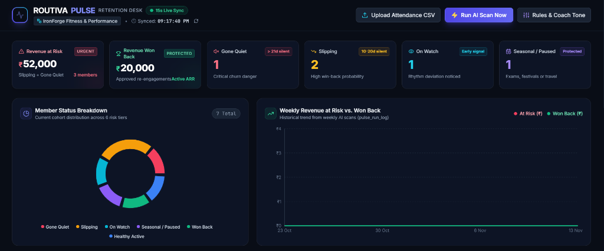
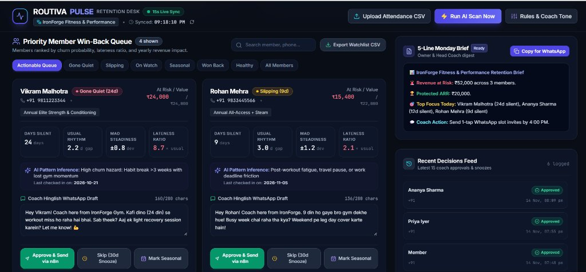
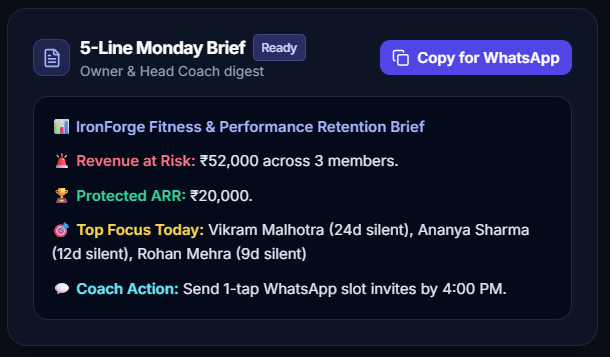

# Routiva Pulse: AI Gym Member Churn & Retention Desk

> A silent churn prediction engine and retention operations desk that monitors workout cadence deviations, computes non-parametric habit breaks, and dispatches verified coach intervention messages via WhatsApp.

---

## The Real-World Problem: Why Gyms Lose Members 3 Weeks Before Renewal

Most gym management software flags churn only when a subscription expires or a payment fails. In fitness operations, that is 21 to 30 days too late.

Members do not decide to cancel on billing day. The decision happens weeks earlier when their training rhythm quietly breaks:
1. A consistent 3-day-a-week lifter misses two workouts due to work travel or soreness.
2. The usual 2-day gap expands to 8 days, then 14 days.
3. Habit decay sets in. Friction builds.
4. By the time the front desk sends an automated "Your membership is expiring" renewal invoice, the member has already emotionally disconnected and refuses to renew.

Standard retention attempts fail for two reasons:
* **Rigid day cutoffs do not fit human behavior:** Flagging everyone absent for 7 days treats a once-a-week Sunday runner (who is totally healthy) the same as a 6-day-a-week athlete absent for 6 days (who is in crisis).
* **Automated corporate messages get ignored:** Impersonal marketing emails ("We miss you! Get 10% off") have single-digit open rates and feel automated.

**Routiva Pulse** replaces blunt rules with an adaptive cadence model. It tracks individual visit intervals, catches deviations early, and drafts localized, coach-personalized Hinglish messages that can be approved and dispatched in one tap.

---

## Visual Walkthrough

### 1. Retention Command Center & Risk Breakdown
The command dashboard aggregates real-time metrics: yearly revenue currently at risk, ARR won back through approved interventions, and active cohorts mapped across six risk tiers.



---

### 2. Priority Member Win-Back Queue
Members are sorted dynamically by churn hazard and revenue impact. Each card provides computed rhythm metrics, pattern inference, an editable Hinglish message ($\le 280$ characters), and action controls that communicate directly with the backend.



---

### 3. Executive Monday Retention Brief
An automated 5-line digest formatted for studio owners and head coaches, ready to paste or dispatch directly to leadership WhatsApp groups every Monday morning.



---

## Engineering Design: Why Split Deterministic Math from LLMs

A common anti-pattern in modern AI applications is asking a large language model to parse timestamps, calculate metrics, and detect anomalies. LLMs are non-deterministic, prone to arithmetic errors, and slow for cohort-level computations.

Routiva Pulse strictly divides responsibilities:
* **The deterministic layer (PostgreSQL + TypeScript/Python)** handles data hygiene, statistical calculations, windowing, and threshold gates.
* **The probabilistic layer (Gemini 2.5 Flash via OpenRouter)** handles natural language tone formulation, vernacular nuances (Hinglish), and context-aware messaging.

```
┌────────────────────────────────────────────────────────────────────────┐
│                      DETERMINISTIC PIPELINE                            │
│                                                                        │
│  [Biometric Attendance]                                                │
│         │                                                              │
│         ▼                                                              │
│  [Deduplication & Clean] ──► Strip refunds & duplicate punches         │
│         │                                                              │
│         ▼                                                              │
│  [Dice Bigram Matcher]   ──► Resolve spelling variations per phone     │
│         │                                                              │
│         ▼                                                              │
│  [Non-Parametric Math]   ──► Calculate Median Gap & MAD Steadiness     │
│         │                                                              │
│         ▼                                                              │
│  [Lateness Ratio Score]  ──► Ratio = Days Silent / Cadence Budget      │
│         │                                                              │
│         ▼                                                              │
│  [Seasonal/Snooze Guard] ──► Filter 365-day exam/festival cycles       │
└───────────────────────────────────┬────────────────────────────────────┘
                                    │
                                    ▼
┌────────────────────────────────────────────────────────────────────────┐
│                        LLM DRAFTING LAYER                              │
│                                                                        │
│  [Gemini 2.5 Flash]      ──► Synthesizes reason & <280 char draft      │
│         │                                                              │
│         ▼                                                              │
│  [Regex Fact Guard]      ──► Verifies every number against raw source  │
│                              (Falls back to template if mismatch)      │
└───────────────────────────────────┬────────────────────────────────────┘
                                    │
                                    ▼
                 [Supabase RPC / n8n WhatsApp Action]
```

---

### 1. Data Cleaning & Fuzzy Name Resolution
Biometric fingerprint scanners and RFID turnstiles frequently generate dirty data:
* Double swipes within 30 minutes of entry.
* Name mismatches between reception billing software ("Vikram M", "Vikram Malhotra", "V Malhotra").
* Cancelled guest passes and transaction refunds.

The cleaning pipeline normalizes phone numbers strictly to the terminal 10 digits (`\D` stripped). Names sharing the exact phone key are resolved using **Dice bigram coefficient string matching**:

$$\text{similarity} = \frac{2 \times |B_X \cap B_Y|}{|B_X| + |B_Y|}$$

Two records are merged only when similarity exceeds $0.82$ and the phone matches. Different phone numbers are never merged, regardless of name similarity.

---

### 2. Non-Parametric Rhythm Scoring
Standard deviations and mean averages fail on attendance data because human workout schedules follow skewed Poisson distributions, not normal curves. A single two-week vacation would heavily distort a member's mean.

Instead, Routiva Pulse uses **non-parametric statistics**:
1. **Median Visit Gap (`usual_gap`):** The middle value of consecutive attendance intervals.
2. **Median Absolute Deviation (`MAD steadiness`):**
   $$\text{MAD} = \text{median}(|x_i - \text{median}(X)|)$$
   A low MAD ($< 1.0$) identifies a member with high routine discipline (e.g., strictly Mon/Wed/Fri). A high MAD ($> 2.5$) identifies an erratic attendee.
3. **Lateness Ratio:**
   $$\text{lateness\_ratio} = \frac{\text{days\_silent}}{\text{usual\_gap} \times \left(1 + 0.5 \times \min(\text{steadiness}, 1)\right)}$$

Disciplined members have a tighter budget for silent days; erratic members are given wider leeway before an alert triggers.
* $\text{lateness\_ratio} \ge 3.0$ or $\text{days\_silent} \ge 21$: **Gone Quiet** (Critical risk)
* $\text{lateness\_ratio} \ge 1.75$ or $\text{days\_silent} \ge 10$: **Slipping** (High recovery probability)
* $\text{lateness\_ratio} \ge 1.25$: **On Watch** (Early deviation)

---

### 3. 365-Day Seasonal & 30-Day Snooze Guards
False alarms destroy staff trust. In Indian fitness clubs, attendance predictably drops during university exam windows (May/November) and major festival weeks (Diwali).

* **Seasonal Guard:** Scans the member's attendance exactly 365 days prior ($\pm 14$ days). If an equivalent multi-week pause occurred during the same calendar month last year and was followed by normal recovery, the member is flagged as `Seasonal Pause` rather than churn risk.
* **Snooze Guard:** When a coach marks a member as `Skipped` (due to known injury, surgery, or verified business travel), a 30-day quiet window is written to `snoozed_until`, suppressing notifications until the snooze expires.

---

### 4. Regex Fact Guard Around Gemini 2.5 Flash
LLMs generating customer messages often hallucinate numbers (e.g., claiming a member missed "5 weeks" when the database shows 12 days).

To guarantee accuracy without expensive human proofreading:
1. The structured prompt supplies verified parameters: `{days_silent}`, `{usual_gap}`, `{coach_name}`, `{gym_vibe}`.
2. Gemini 2.5 Flash returns the draft message ($\le 280$ characters).
3. A deterministic **Regex Fact Guard** extracts all numbers from the generated text:
   ```typescript
   const numbersInDraft = draft.match(/\b\d+\b/g) || [];
   const isValid = numbersInDraft.every(num => 
     allowedMetrics.includes(parseInt(num, 10))
   );
   ```
4. If the model introduces any digit not present in the verified input data, the response is discarded and replaced with a deterministic template fallback.

This approach reduces token expenditure by over 80% compared to multi-agent debate setups while ensuring zero metric hallucinations reach members.

---

## Technical Stack & System Architecture

| Tier | Technology | Purpose |
| :--- | :--- | :--- |
| **Frontend** | React 18, TypeScript, Vite | Dark-mode single-page application |
| **Styling** | Tailwind CSS, Lucide React | Glassmorphism UI, risk badges, responsive layouts |
| **Analytics** | Recharts | Donut cohort distribution and dual-gradient ARR trends |
| **Database** | Supabase (PostgreSQL 15) | Relational persistence, Row-Level Security, compound indexes |
| **RPC Layer** | PL/pgSQL | Single-trip state aggregation (`get_pulse_desk_data`) and atomic batch writes |
| **Automation** | n8n | 29-node workflow handling data ingestion, cron schedules, and webhook routing |
| **AI Layer** | OpenRouter (`gemini-2.5-flash`) | Context-aware Hinglish copy generation |
| **Delivery** | Meta WhatsApp Cloud API | Interactive quick-reply template messaging to owners and members |

---

## Database Design & RPC Layer

All operations run against PostgreSQL tables secured by Row-Level Security:

```sql
public.pulse_rules             -- Thresholds, studio name, owner WhatsApp ID
public.pulse_tone              -- Coach persona, language blend, signature
public.pulse_attendance_logs   -- Raw turnstile swipe stream
public.pulse_watchlist         -- Computed member risk profiles and drafts
public.pulse_decisions         -- Audit trail of coach actions
public.pulse_run_log           -- Historical weekly scan snapshots
```

### High-Performance RPC Aggregation
Rather than firing five independent queries on client mount, the frontend invokes a single database function:

```sql
select * from public.get_pulse_desk_data();
```

This PL/pgSQL function bundles the watchlist, run logs, recent decisions, tone settings, and operational rules into a single JSONB object, cutting network overhead and eliminating race conditions.

---

## Local Setup & Development

### 1. Clone & Install Dependencies
```bash
git clone https://github.com/PraveenBhagwani/routiva-pulse.git
cd routiva-pulse
npm install
```

### 2. Configure Environment Variables
Copy the example environment template:
```bash
cp .env.example .env
```

Edit `.env` with your Supabase project credentials:
```env
VITE_SUPABASE_URL=https://oqttljgjwyzoqsxqwoap.supabase.co
VITE_SUPABASE_ANON_KEY=your-supabase-publishable-key
VITE_N8N_WEBHOOK_BASE_URL=https://your-n8n-instance.app.n8n.cloud
```

### 3. Initialize the Database
Open the SQL Editor in your Supabase dashboard and execute the script located at:
```
supabase/schema.sql
```
This creates the tables, grants, RLS policies, PL/pgSQL RPC functions, and sample seed data.

### 4. Import n8n Automation
1. Open your n8n workspace.
2. Follow the setup guide in [n8n/README.md](n8n/README.md).
3. Import the webhook orchestration workflow and supply your credentials (`OPENROUTER_API_KEY`, `WHATSAPP_CLOUD_API_TOKEN`, `SUPABASE_SERVICE_ROLE_KEY`).

### 5. Run the Local Development Server
```bash
npm run dev
```
The application will launch at `http://localhost:5173/`.

### 6. Verify Production Build
```bash
npx tsc --noEmit && npm run build
```

---

## License
MIT License. Built for independent fitness clubs, studios, and retention teams.
